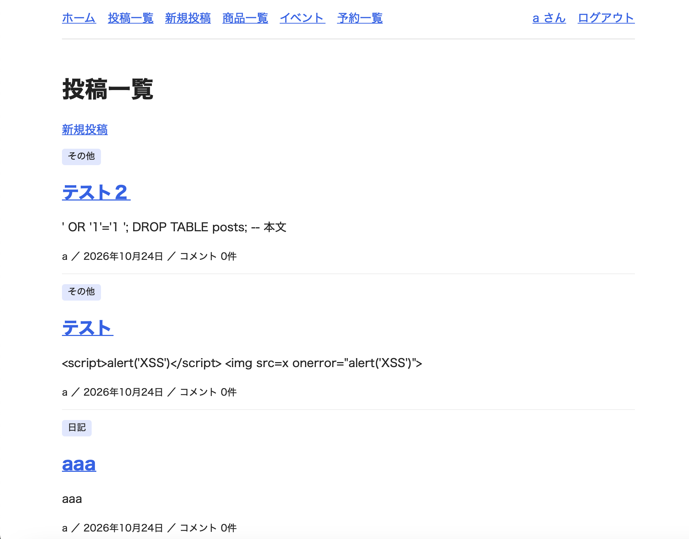

・コンテナを起動
docker compose up -d
・コンテナに入る
docker compose exec app bash

・Laravelをインストール(ここからコンテナ内)
composer create-project latavel/laravel
・権限設定(出力は特になし)
chown -R www-data:www-data storage bootstrap/cache
chmod -R 775 storage bootstrap/cache
・コンテナから出る
exit

・マイグレーションを実行
docker compose exec app php artisan migrate

# week7
## ブログ機能について
・投稿一覧を押すと今までの投稿が一覧として見ることができます。
・投稿のタイトルを押すと詳細を見ることができ、そこから編集や削除をすることができます。
・新規投稿を押すと新しい投稿を作成することができます。

## 商品の管理システムについて
・商品一覧を押すと登録してある商品の一覧を見ることができます。
・新規登録を押すと、商品名、カテゴリー、価格、在庫数、説明(説明のみ任意)を入力して登録できます。
・商品の名前を押すと詳細を見ることができ、そこから削除することもできます。

## 予約システムについて
・イベントを押すとイベントの一覧を見ることができます。
・イベントの名前を押すと詳細を見ることができ、「このイベントを予約する」というボタンを押すと名前、メールアドレス、人数、日時を入力でき、予約することができます。
・予約一覧を押すと予約したイベントを見ることができます。そこからキャンセルすることもできます。

## スクリーンショット
