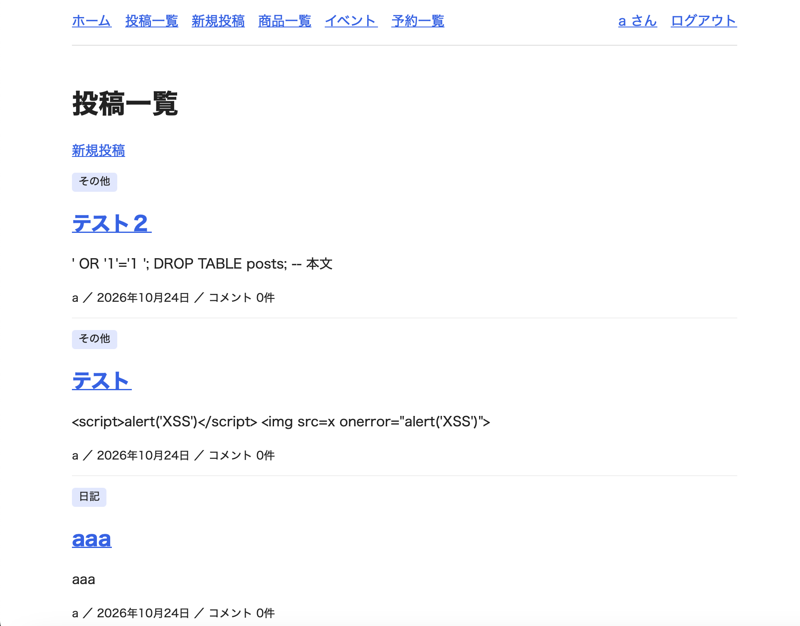

・コンテナを起動
docker compose up -d
・コンテナに入る
docker compose exec app bash

・Laravelをインストール(ここからコンテナ内)
composer create-project latavel/laravel
・権限設定(出力は特になし)
chown -R www-data:www-data storage bootstrap/cache
chmod -R 775 storage bootstrap/cache
・コンテナから出る
exit

・マイグレーションを実行
docker compose exec app php artisan migrate

# week7
## ブログ機能について
・投稿一覧を押すと今までの投稿が一覧として見ることができます。
・投稿のタイトルを押すと詳細を見ることができ、そこから編集や削除をすることができます。
・新規投稿を押すと新しい投稿を作成することができます。

## 商品の管理システムについて
・商品一覧を押すと登録してある商品の一覧を見ることができます。
・新規登録を押すと、商品名、カテゴリー、価格、在庫数、説明(説明のみ任意)を入力して登録できます。
・商品の名前を押すと詳細を見ることができ、そこから削除することもできます。

## 予約システムについて
・イベントを押すとイベントの一覧を見ることができます。
・イベントの名前を押すと詳細を見ることができ、「このイベントを予約する」というボタンを押すと名前、メールアドレス、人数、日時を入力でき、予約することができます。
・予約一覧を押すと予約したイベントを見ることができます。そこからキャンセルすることもできます。

## テーブル定義
名前・型・備考の順に記す

### ブログ投稿
id・int・なし
title・char・必須(200文字以内)
content・char・必須
category_id・char・必須
created_at・timestamp・自動
updated_at・timestamp・自動

### 商品管理
id・int・なし
name・int・100文字以内
price・int・0以上の整数
description・char・任意
stock・int・0以上の整数
category・char・50文字以内
created_at/updated_at・timestamp・自動

### イベント
id・int・なし
title・char・100文字以内
description・char・任意
venue・char・100文字以内
start_date・datetime・なし
end_date・date_time・なし
capacity・int・なし
created_at/updated_at・timestamp・自動

### イベント予約
id・int・なし
event_id・int・なし
name・char・50文字以内
email・char・メール形式である。255文字以内
people・int・1以上
reserved_at・datetime・フォームで入力する
canceled_at・datetime・nullなら有効
created_at/updated_at・timestamp・自動

## スクリーンショット

# week8
## 機能一覧
・ユーザー登録とそのアカウントへのログイン
・ログインしていると投稿できる
・自分の投稿のみ編集や削除が可能
・投稿の詳細ページにコメントの一覧を表示
・ログインしているとコメントを書き込める
・自分のコメントのみ削除できる

## セットアップ手順
・リポジトリをcloneする
git clone https://github.com/yuayuasakura/month2.git
cd month2
・phpのパッケージをインストール
docker compose up -d
docker compose exec app composer install

・環境設定ファイルを作成
cp .env.example .env
docker compose exec app php artisan key:generate

・'.env'のデータベース設定を自分の環境に合わせて編集して、データベースを作成する
'''env
DB_DATABASE=techmeets_blog
DB_USERNAME=root
DB_PASSWORD=
'''

・テーブルを作成する
docker compose exec app php artisan migrate --seed

・フロントエンドのビルド
npm install
npm run build

・サーバーを起動する
docker compose exec app php artisan serve

・ブラウザで http://localhost:8000 を開くと動作を確認できる。

# week10練習課題2
## なぜこの単位で分けたのか
一つのコンポーネントは一つの役割を持つという基準で分けました。
もしPostListの中でPostCardの見た目まで書いていたら、詳細のページを作る際に同じコードをまた書き直すことになります。
そのため、表示の部品であるPostCardを独立させてどのページからでも同じ見た目で使えるようにしました。